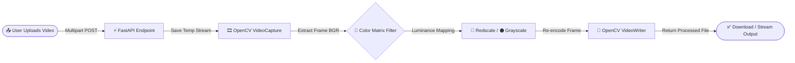

<div align="center">

  

  # 🎬 Video Filter Engine
  ### **High-Performance Video Processing & Color Transformation Pipeline**

  <p align="center">
    An asynchronous computer vision web application built with <b>FastAPI</b> and <b>OpenCV</b> that transforms video streams frame-by-frame using custom color matrix manipulation.
    <br />
    <br />
    <a href="#-quick-start"><strong>🚀 Quick Start</strong></a> ·
    <a href="#-how-it-works-pipeline"><strong>⚙️ Architecture</strong></a> ·
    <a href="#-api-endpoints"><strong>📡 API Docs</strong></a> ·
    <a href="https://github.com/Adamnazeri/videofilterproject/issues"><strong>🐞 Report Bug</strong></a>
  </p>

  <!-- STATUS BADGES -->
  [](https://www.python.org/)
  [](https://fastapi.tiangolo.com/)
  [](https://opencv.org/)
  [](https://numpy.org/)
  [](https://www.uvicorn.org/)

</div>

<br />

---

## 🌟 Highlights & Capabilities

<table>
  <tr>
    <td width="50%">
      <h3>⚡ Asynchronous Video Pipeline</h3>
      <p>Powered by <b>FastAPI</b> and <b>Uvicorn</b>, enabling non-blocking multipart video uploads and rapid server-side stream handling without freezing the client interface.</p>
    </td>
    <td width="50%">
      <h3>🎨 Custom BGR Matrix Filters</h3>
      <p>Utilizes <b>OpenCV</b> and <b>NumPy</b> array operations to strip, isolate, and reconstruct color channels—converting standard footage into striking <b>Redscale</b> or <b>Grayscale</b> outputs.</p>
    </td>
  </tr>
  <tr>
    <td width="50%">
      <h3>🎞️ Native FPS & Resolution Lock</h3>
      <p>Automatically extracts source metadata (frame width, height, and FPS) via <code>cv2.VideoCapture</code> to ensure the rendered output matches original quality.</p>
    </td>
    <td width="50%">
      <h3>📖 Interactive Swagger UI</h3>
      <p>Comes with built-in OpenAPI documentation at <code>/docs</code>, allowing developers and users to test video uploads directly from the browser with zero frontend setup.</p>
    </td>
  </tr>
</table>

---

## ⚙️ How It Works (Pipeline)

GitHub automatically renders the architecture flow below. Every uploaded video passes through a 5-stage computer vision pipeline:



### 🎨 Color Channel Transformation Breakdown

OpenCV reads video frames in **BGR (Blue, Green, Red)** format rather than standard RGB. Below is how each pixel matrix is transformed during processing:

| Filter Mode | Blue Channel (`B`) | Green Channel (`G`) | Red Channel (`R`) | Visual Output |
| :--- | :---: | :---: | :---: | :--- |
| **Original Source** | `0 – 255` | `0 – 255` | `0 – 255` | 🌈 Full Color Video |
| **Grayscale Mode** | `Y (Luminance)` | `Y (Luminance)` | `Y (Luminance)` | ⚫ Classic Monochrome |
| **Redscale Mode** | `0` *(Zeroed)* | `0` *(Zeroed)* | `Y (Luminance)` | 🔴 High-Contrast Crimson |

---

## 🛠️ Tech Stack Overview

| Layer | Badge | Role in Project |
| :--- | :---: | :--- |
| **API Framework** |  | Handles routing, file validation, and async request lifecycle |
| **Computer Vision** |  | Decodes video streams, applies color space transforms, and encodes output |
| **Matrix Engine** |  | Performs high-speed 3D array slicing and zero-channel merging |
| **ASGI Server** |  | Runs the production-ready asynchronous Python web server |

---

## 🚀 Quick Start

> [!IMPORTANT]
> Make sure you have **Python 3.9+** and **Git** installed on your system before starting.

### 1️⃣ Clone the Repository
```bash
git clone [https://github.com/Adamnazeri/videofilterproject.git](https://github.com/Adamnazeri/videofilterproject.git)
cd videofilterproject
```

### 2️⃣ Set Up Virtual Environment

<details open>
<summary><b>🪟 Windows (Command Prompt / PowerShell)</b></summary>

```bash
python -m venv venv
venv\Scripts\activate
```
</details>

<details>
<summary><b>🍎 macOS / 🐧 Linux</b></summary>

```bash
python3 -m venv venv
source venv/bin/activate
```
</details>

### 3️⃣ Install Dependencies
```bash
pip install fastapi uvicorn opencv-python numpy python-multipart
```

### 4️⃣ Launch the Server
```bash
uvicorn main:app --reload
```

> [!TIP]
> Once the server is running, open your browser and go straight to **`http://127.0.0.1:8000/docs`** to test uploading a video using the interactive Swagger UI!

---

## 📡 API Endpoints

| HTTP Method | Endpoint | Content-Type | Description |
| :---: | :--- | :--- | :--- |
| `GET` | `/` | `application/json` / `text/html` | Root health check / main interface |
| `POST` | `/upload_video` | `multipart/form-data` | Uploads a video file and returns the filtered video output |
| `GET` | `/docs` | `text/html` | Interactive Swagger UI API documentation |

### 🧪 Example cURL Request
Want to test the API straight from your terminal? Run this command with any `.mp4` file:

```bash
curl -X POST "[http://127.0.0.1:8000/upload_video](http://127.0.0.1:8000/upload_video)" \
  -H "accept: application/json" \
  -H "Content-Type: multipart/form-data" \
  -F "file=@sample_video.mp4" \
  --output filtered_output.mp4
```

---

## 📂 Directory Structure

```text
videofilterproject/
├── 📄 main.py                 # Core FastAPI app & OpenCV frame transformation logic
├── 📄 requirements.txt        # Python dependencies list
├── 📁 static/                 # Exported/processed video storage & static assets
├── 📁 templates/              # Web frontend templates (if applicable)
└── 📄 README.md               # Project documentation
```

---

## 🔧 Troubleshooting & FAQ

<details>
<summary><b>❓ Error: "Form data requires python-multipart to be installed"</b></summary>
<br />
FastAPI requires <code>python-multipart</code> to parse uploaded files. Run:
<pre><code>pip install python-multipart</code></pre>
</details>

<details>
<summary><b>❓ Output video cannot be played in browser / media player</b></summary>
<br />
Ensure your system supports the FourCC codec configured in <code>cv2.VideoWriter_fourcc</code> (such as <code>mp4v</code> or <code>avc1</code>). VLC Media Player is recommended for universal playback support.
</details>

---

<div align="center">

## 👨‍💻 Developed By

**Adam Nazeri**  
[](https://github.com/Adamnazeri)

*If you find this project useful, don't forget to give it a ⭐ on GitHub!*

</div>
